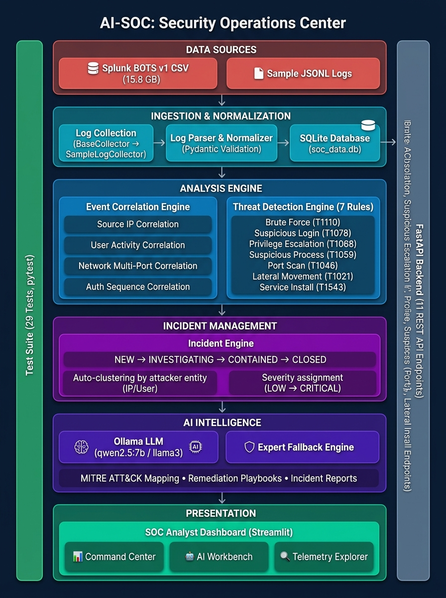

# AI-SOC — System Architecture

## Architecture Diagram



---

## Architecture Overview

AI-SOC is a **6-layer, fully local Security Operations Center** built on the philosophy:

> *"Strict, Deterministic Rules Detect Threats — AI Translates, Explains, and Guides Response."*

Every layer feeds into the next, forming a unidirectional data pipeline from raw telemetry to analyst-ready incident reports.

---

## Layer Breakdown

### Layer 1 — Data Sources
| Source | Description | Size |
|--------|-------------|------|
| **Splunk BOTS v1 CSV** | Authentic Windows Security Event Logs from a red-team simulation (Wayne Enterprises) | 15.8 GB / 13.4M rows |
| **Sample JSONL Logs** | Lightweight portable event files extracted from BOTS v1 or manually created | ~442 KB / 1,508 events |

**Windows Event Codes Ingested:**

| Event Code | Meaning | Maps To |
|------------|---------|---------|
| 4624 | Successful logon | `authentication` / `login` / `success` |
| 4634 | Logoff | `authentication` / `logout` / `success` |
| 4648 | Explicit credential logon | `authentication` / `login` / `success` |
| 4672 / 4703 | Special privileges assigned | `system` / `privilege_escalation` |
| 4673 | Privileged service call failure | `system` / `privilege_escalation` / `failed` |
| 4688 | New process created | `system` / `process_execution` |
| 4697 | Service installed | `system` / `privilege_escalation` |

---

### Layer 2 — Ingestion & Normalization

```
Raw JSONL → BaseCollector → SampleLogCollector → LogParser → Normalizer → Pydantic Validation → SQLite
```

| Component | File | Responsibility |
|-----------|------|----------------|
| **BaseCollector** | `backend/collectors/base.py` | Abstract interface for pluggable log sources |
| **SampleLogCollector** | `backend/collectors/sample.py` | Reads JSONL files line-by-line, handles malformed JSON |
| **LogParser** | `backend/parser/parser.py` | Orchestrates normalization + validation |
| **Normalizer** | `backend/parser/normalizer.py` | UUID generation, lowercase fields, port casting, IP validation |
| **NormalizedEvent** | `backend/parser/models.py` | Pydantic model enforcing schema integrity |
| **DatabaseManager** | `backend/database/manager.py` | SQLite CRUD with indexed tables |

**Normalization Rules Applied:**
1. Auto-generate UUID4 `event_id` if missing
2. Lowercase `status`, `event_type`, `action`
3. Cast `source_port` / `destination_port` to `int` (or `None`)
4. Validate IP address format
5. Normalize timestamps to ISO 8601

**Database Indexes:** `timestamp`, `source_ip`, `event_type`

---

### Layer 3 — Analysis Engine

Two engines work in sequence: **Correlation** groups related events, then **Detection** classifies grouped patterns against known threats.

#### Event Correlation Engine (`backend/correlation/engine.py`)

| Strategy | Logic | Minimum Cluster Size |
|----------|-------|----------------------|
| **Source IP** | Group events by same `source_ip` within time window | 2 events |
| **User Activity** | Group by `(username + source_ip)` composite key | 2 events |
| **Network Multi-Port** | Group network events hitting ≥2 unique destination ports | 2 unique ports |
| **Auth Sequence** | Detect ordered patterns: failed → success → privilege escalation → execution | 2 events (with failed+success or success+system) |

- **Time Window:** Configurable (default: 300s / 5 minutes)
- **Deduplication Priority:** `auth_sequence(3)` > `network_scan(3)` > `user_activity(2)` > `source_ip(1)`

#### Threat Detection Engine (`backend/detection/engine.py` + `rules.py`)

| Rule ID | Type | Severity | Trigger Condition | MITRE |
|---------|------|----------|-------------------|-------|
| `RULE_BRUTE_FORCE_01` | Brute Force | HIGH | ≥5 failed logins from same IP | T1110 |
| `RULE_SUSPICIOUS_LOGIN_01` | Suspicious Login | HIGH | Success after ≥3 failures | T1078 |
| `RULE_PRIVILEGE_ESCALATION_01` | Privilege Escalation | CRITICAL | Event 4672/4703, sudo su, admin granted | T1068 |
| `RULE_SUSPICIOUS_PROCESS_01` | Suspicious Process | HIGH | 25+ known malicious commands | T1059.001 |
| `RULE_PORT_SCAN_01` | Port Scan | MEDIUM | ≥5 unique destination ports from one IP | T1046 |
| `RULE_LATERAL_MOVEMENT_01` | Lateral Movement | HIGH | Explicit credential logons (4648) across hosts | T1021 |
| `RULE_SERVICE_INSTALL_01` | Service Install | CRITICAL | Malicious Windows service creation (4697) | T1543.003 |

**Evaluation Strategy:** Each rule evaluates both individual events (`evaluate_event`) and correlated sequences (`evaluate_correlation`).

---

### Layer 4 — Incident Management

```
Unassigned Detections → Group by Entity → Assign Severity → Create Ticket → SQLite
```

| Component | Details |
|-----------|---------|
| **Clustering Key** | `source_ip` or `username` (fallback: `UNKNOWN_ENTITY`) |
| **Severity Calculation** | Maximum severity across all detections in the group |
| **Title Generation** | Multi-type: `"Multi-Stage Attack: TYPE1 → TYPE2 from IP"` / Single-type: `"TYPE Incident from IP"` |
| **Lifecycle States** | `NEW` → `INVESTIGATING` → `CONTAINED` → `CLOSED` |
| **Tracking Fields** | `assigned_analyst`, `notes`, `remediation_notes`, `updated_at` |

---

### Layer 5 — AI Intelligence

```
Incident Data → Try Ollama LLM → (Fallback to Expert Engine) → MITRE Mapping → Remediation → Report
```

| Component | Description |
|-----------|-------------|
| **Primary: Ollama LLM** | Local `qwen2.5:7b` or `llama3` at `localhost:11434` (8s timeout) |
| **Fallback: Expert Engine** | Deterministic MITRE catalog + curated remediation playbooks (zero external dependency) |
| **MITRE ATT&CK Coverage** | 7 techniques: T1110, T1078, T1068, T1059.001, T1046, T1021, T1543.003 |
| **Report Sections** | Executive Summary → Threat Evidence → MITRE Table → Remediation Playbook → Event Timeline |

**Key Design Decision:** The SOC remains fully functional even without an LLM running. The expert fallback produces MITRE mappings and remediation steps from a pre-built knowledge matrix.

---

### Layer 6 — Presentation (SOC Dashboard)

| Tab | Features |
|-----|----------|
| **📊 SOC Command Center** | Real-time metric cards (events, detections, incidents, active count), detection feed with severity badges, incident queue table |
| **🤖 Incident Investigation & AI Workbench** | Incident selector, one-click AI analysis, MITRE ATT&CK table, remediation checklist, downloadable `.md` report, status/analyst update form |
| **🔍 Telemetry Explorer** | Full-text search across normalized events, timestamped log table |

**Tech Stack:** Streamlit with custom dark-mode CSS, communicating with FastAPI backend via HTTP.

---

## Cross-Cutting Components

### FastAPI Backend (`backend/main.py`)
Serves as the **central orchestration layer**, exposing 13 REST endpoints that the dashboard and external clients consume:

| Method | Endpoint | Layer |
|--------|----------|-------|
| `GET` | `/` | Health |
| `GET` | `/health` | Health |
| `GET` | `/api/logs/sample` | Ingestion |
| `POST` | `/api/logs/collect` | Ingestion |
| `GET` | `/api/events` | Storage |
| `GET` | `/api/correlation` | Correlation |
| `POST` | `/api/detection/run` | Detection |
| `GET` | `/api/detections` | Detection |
| `POST` | `/api/incidents/generate` | Incidents |
| `GET` | `/api/incidents` | Incidents |
| `GET` | `/api/incidents/{id}` | Incidents |
| `PATCH` | `/api/incidents/{id}` | Incidents |
| `POST` | `/api/incidents/{id}/ai-analysis` | AI |

### Test Suite (`tests/`)
29 unit and integration tests across 8 test files covering every layer of the architecture:

| Test File | Coverage |
|-----------|----------|
| `test_collectors.py` | JSONL file reading, error handling |
| `test_parser.py` | Pydantic normalization, IP/port validation |
| `test_correlation.py` | All 4 correlation strategies |
| `test_detection.py` | All detection rules |
| `test_incidents.py` | Incident grouping, lifecycle, PATCH updates |
| `test_ai_assistant.py` | AI analysis, MITRE mapping, report generation |
| `test_botsv1_pipeline.py` | End-to-end BOTS v1 data ingestion → detection |
| `test_pipeline.py` | Full API pipeline integration test |

### Configuration (`backend/config.py`)
Pydantic `BaseSettings` loading from environment variables or `.env` file:

```python
project_name               = "AI-SOC"
sqlite_db_path             = "sqlite:///./soc_data.db"
correlation_window_seconds = 300
ollama_host                = "http://localhost:11434"
ai_model_name              = "qwen2.5:7b"
brute_force_threshold_count = 5
port_scan_unique_ports      = 5
```

---

## Technology Stack

| Category | Technology |
|----------|-----------|
| **Backend API** | Python, FastAPI, Uvicorn |
| **Data Validation** | Pydantic, pydantic-settings |
| **Database** | SQLite3 (file: `soc_data.db`) |
| **AI / LLM** | Ollama (local), qwen2.5:7b / llama3 |
| **HTTP Client** | httpx |
| **Dashboard** | Streamlit |
| **Testing** | pytest |
| **Data Source** | Splunk BOTS v1 (CSV), JSONL |

---

## Design Principles

1. **Deterministic Detection First** — All threat detection is rule-based with zero AI involvement. No hallucinations, no false positives from generative models.
2. **AI as Analyst Copilot** — AI translates, maps, and recommends. It never decides whether something is a threat.
3. **Graceful Degradation** — If Ollama is offline, the expert fallback engine provides identical MITRE mappings and remediation playbooks.
4. **Completely Local / Air-Gapped** — Zero external cloud dependencies. Everything runs on `localhost`.
5. **Modular & Extensible** — Each phase is an independent module. New collectors, detection rules, or correlation strategies can be added without modifying existing code.
